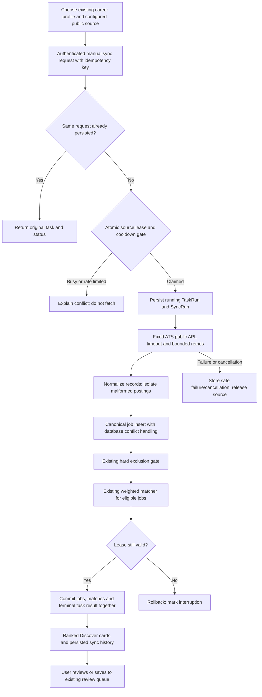

# Phase 5: manual discovery automation foundation

Branch: `codex/phase-5-automation`, based on the preserved frontend `6f984d8`.
The frontend feature branch is now uploaded. Main has not been changed or merged.
See `AUTOMATION_GAP_ANALYSIS.md` for the source-based baseline audit.

## Architecture decision

Keep orchestration in Python and PostgreSQL, beginning with a bounded manual
request. Add Celery/Redis only when a continuously supervised queue and scheduler
are justified. Keep discovery, eligibility, deduplication, ranking and approval
inside the application even if an external scheduler is introduced later.

The comparison below is an engineering assessment of this repository, not a
vendor benchmark. The current repository has no broker, worker or orchestration
platform, and local development uses Windows and SQLite.

| Criterion | Python with Celery + Redis | External n8n | Hybrid n8n → Python |
| --- | --- | --- | --- |
| Reliability | Durable broker/worker deployment; still requires idempotency, supervision and database transaction control. | Queue mode uses separate main/worker processes and Redis; application invariants still require backend enforcement. | Two execution/control planes to operate; Python retains business invariants. |
| Scheduling | Celery beat dispatches periodic tasks; one scheduler and overlap protection are needed. | Timers/webhooks dispatch workflow executions; scheduler administration moves outside the app. | n8n dispatches sync IDs; Python decides whether execution is safe. |
| Rate limits | Worker policy plus shared source cooldown; per-worker task limits alone are insufficient across workers. | Workflow pacing cannot replace the backend's source-wide rate gate. | Backend gate remains authoritative regardless of trigger frequency. |
| Retries/backoff | Built-in retry/backoff/jitter policies can wrap the existing executor. | Must coordinate workflow retries with backend idempotency rather than replaying individual database writes. | One layer should own fetch retries; outer triggers should reuse keys. |
| Queue management | Explicit Redis broker, workers, routing and backlog monitoring. | Queue mode adds Redis and Node workers alongside its database. | More queues/processes if both systems execute work; avoid duplicating them. |
| Database consistency | SQLAlchemy can commit catalog, matches and terminal result in one transaction. | Direct SQL nodes would scatter application logic and transaction boundaries. | Python API owns transactions; n8n must not write business tables directly. |
| Secrets | Server-side environment/secret manager; queue messages carry IDs, not candidate data or secrets. | Credential encryption key must be consistent across workers. | Adds a service credential boundary requiring rotation and least privilege. |
| Observability | Application task history, structured logs; broker/worker metrics would be added later. | Separate workflow execution history and worker health/metrics; application history still required. | Correlation IDs needed between the two histories. |
| Local development | Existing Python tests remain useful; Celery does not officially support native Windows, so use Linux/WSL/containers for that stage. | Adds a Node service and, for queue mode, Redis and database connectivity. | Largest local setup and debugging burden. |
| Future deployment | FastAPI + PostgreSQL + worker + Redis + beat, with explicit supervision and backup policies. | FastAPI + PostgreSQL plus n8n runtime, its persistence and optional queue workers. | Most moving parts; reasonable only when independent workflow integrations justify it. |
| Operating cost | No new service in this manual slice; future broker/worker/monitoring capacity and maintenance have costs. | Hosting, upgrades, backups and any licensed/cloud features must be budgeted. No price assumption is made. | Combined service and operational costs; highest maintenance burden for the present scope. |

Primary documentation: Celery's [task retry, logging and delivery policies](https://docs.celeryq.dev/en/stable/userguide/tasks.html),
[periodic-task overlap guidance](https://docs.celeryq.dev/en/stable/userguide/periodic-tasks.html),
[Windows support boundary](https://docs.celeryq.dev/en/main/faq.html#does-celery-support-windows),
and n8n's [queue architecture, shared encryption key, database and worker requirements](https://docs.n8n.io/deploy/host-n8n/configure-n8n/scaling/enable-queue-mode.md).
The cost and fit assessments above are project-specific inferences; no platform
was installed, account connected or deployment performed in this phase.

## Delivered execution flow



## Implementation and behavior

* Existing `JobSource`, `Job`, `JobMatch`, `TaskRun`, career profiles, matcher and
  application staging are reused. Two additive tables, `sync_sources` and
  `sync_runs`, store configuration, leases, ownership, request uniqueness and
  cancellation. Existing business tables are not rebuilt.
* `POST /api/v1/automation/sources` registers or updates a supported provider and
  board slug. It accepts an active flag, 1–60 requests/minute (default 30), and an
  optional future interval of 15–10,080 minutes. `scheduler_enabled` is always
  false: configuring an interval does not enable unattended runs.
* `GET /automation/sources`, `GET /automation/syncs?profile_type=software`,
  `GET /automation/syncs/{id}` and `POST /automation/syncs/{id}/cancel` are
  authenticated and owner-scoped. Source controls follow the existing single-user
  product: one configured owner per source; this is not a tenant-shared catalog.
* `POST /automation/syncs` accepts `source_id`, existing `profile_type`, `limit`
  (1–100) and `idempotency_key` (8–64 letters, digits, underscores or hyphens).
  Reusing the same key/request returns its original task without fetching again.
  Changing the request under the same key returns 409. A new manual retry uses a
  new key; canonical job and profile/job constraints prevent duplicate results.
* `prepare` persists a running task and atomically claims the source. `execute`
  awaits completion in the request; it is a future worker entry point, not an
  installed durable queue. A 120-second lease fences stale execution, and a
  90-second async execution budget bounds network/retry waits. Individual HTTP
  requests use 10-second timeouts, no redirects and fixed provider hosts.
* Fetches get at most three attempts for network/timeout/429/5xx failures.
  Backoff is 1 then 2 seconds, also respecting persisted source pacing and
  `Retry-After`. Other HTTP errors or malformed response envelopes fail directly.
  A cooldown longer than the execution budget is retained for the next trigger;
  it does not cause rapid retrying.
* Empty valid boards succeed with zero counts. Invalid individual records produce
  `partial` status with a rejected count; valid records remain usable. Failures
  remain visible as failures, with no false success count.
* The existing hard gate excludes companies. Work-mode incompatibility is marked
  for human review, including remote-only preferences. Visa, salary and location
  eligibility are not inferred from absent provider data. Their enforcement is
  still a remaining integration gap.
* Eligible results receive the existing 40/25/20/15 heuristic score and evidence.
  Ineligible jobs are retained in the canonical catalog for audit/other profiles
  but excluded from profile-specific Discover and have no ranking for that
  profile. Matching recalculation removes stale excluded rankings.
* Jobs, matches, successful poll time and terminal success share one transaction.
  Failed persistence rolls back all newly staged results. Expired orphaned tasks
  are marked interrupted when history/sources are read or another run is prepared;
  they are never silently replayed. Cancellation is cooperative between waits,
  requests and persistence, not an immediate interruption of a blocking DB call.
* The legacy `/jobs/discover` API delegates to the tracked workflow, retaining its
  existing response shape and defaulting to the software profile. The new UI uses
  the richer control API. Existing job review/save APIs are unchanged. Saving
  creates `ready_for_review`, and saved state survives reloading Discover.
* Task logs contain event, task/source IDs, attempt or exception class, without
  raw job payloads, SQL error text, credentials or candidate facts. Analytics sees
  owned sync history; pre-existing unowned legacy tasks remain visible only to
  the single-user superuser for compatibility.

## Run locally

For an existing **Alembic-managed** database, stop its API process and make the
normal database backup first. In PowerShell:

```powershell
Set-Location 'C:/Users/adars/OneDrive/Desktop/Opporbyte/backend'
./.venv/Scripts/python.exe -m alembic current
./.venv/Scripts/python.exe -m alembic upgrade head
./.venv/Scripts/python.exe -m uvicorn app.main:app --host 127.0.0.1 --port 8000
```

Existing environment/database settings are used. No owner database was migrated
or started during this task. A legacy database created only by `create_all` may
have no Alembic revision: inspect and reconcile/stamp its verified baseline after
backup rather than applying the initial migration over existing tables. Startup
still uses the project's existing `create_all` bootstrap; new installations can
run the complete migrations before first startup.

In a second terminal:

```powershell
Set-Location 'C:/Users/adars/OneDrive/Desktop/Opporbyte/frontend'
npm run dev -- --port 3002
```

Use `http://localhost:3002/app/discover`, sign in with the existing owner account,
select the active profile, click **Connect a job board**, enter a public employer
board slug, and choose **Configure and sync**. Subsequent runs use **Sync now**.
Review the counts/history, open a role and save it to the review queue. The
production/public preview at port 3001 uses the normal backend rewrite on 8000.

For a safe, fictional review without owner data or external calls, from the root:

```powershell
Set-Location 'C:/Users/adars/OneDrive/Desktop/Opporbyte'
$qaDatabase = Join-Path $PWD ('output/playwright/phase5-' + [DateTimeOffset]::UtcNow.ToUnixTimeMilliseconds() + '.db')
backend/.venv/Scripts/python.exe frontend/tests/support/qa_backend.py --database $qaDatabase --port 8011 --mock-sources
```

In a separate frontend terminal set `$env:OPPORBYTE_API_URL='http://127.0.0.1:8011'`
before `npm run dev -- --port 3002`. Fixture sign-in:
`frontend-fixture@example.com` / `isolated-test-owner-password`. Use
`fixture-board` for duplicates/malformed records, `fixture-failure` for bounded
503 failure and `fixture-slow` for cancellation. The fixture rejects other board
identifiers, refuses an existing DB path, and never contacts an ATS. Do not use
fixture credentials or source data as an owner account or real vacancy.

## Validation

Current backend result: **51 passed**, including the original 27 regressions and
24 new automation/adapter/migration checks. Frontend: **18 unit tests passed**,
ESLint and TypeScript passed, production build passed with 27 static pages.
Only the existing Starlette/httpx TestClient deprecation warning remains in the
backend run. PostgreSQL migration SQL generation passed; an actual PostgreSQL
server/concurrent runtime was not available and has not been qualified.

Exact isolated regression commands:

```powershell
Set-Location 'C:/Users/adars/OneDrive/Desktop/Opporbyte/backend'
$env:DATABASE_URL='sqlite:///:memory:'
$env:FIRST_USER_EMAIL='frontend-fixture@example.com'
$env:FIRST_USER_PASSWORD='isolated-test-owner-password'
$env:SECRET_KEY='isolated-phase5-test-secret-key-with-32-bytes'
./.venv/Scripts/python.exe -m pytest -q
Set-Location '../frontend'
npm test
npm run lint
npm run typecheck
npm run build
```

Run those variables in a dedicated test terminal; do not reuse it to start the
owner API. Browser verification is in `frontend/tests/phase5-sync-browser.txt`
and the preserved `stabilization-*.txt` drivers; final results are recorded in
`docs/PHASE5_QA.md`.

## Remaining limitations and next sprint

1. Qualify PostgreSQL transactions, multiple processes, recovery and throughput
   against a disposable Postgres service before deploying a worker. Add a
   transaction/outbox dispatch boundary and a supervised Celery worker/beat only
   when enabling scheduled execution; keep the source lease and idempotency.
2. Harden production auth/CSRF/default secret handling and application status/
   resume-reference updates. Before any submission integration, enforce explicit
   approval transitions and store provider-confirmed receipts separately from
   user-reported tracking. No submission provider exists in this phase.
3. Remove fictional verified fact seeding from real workflows, constrain summary
   wording to supported facts and escape HTML export. Sync does not invoke facts,
   tailoring or submission, so it does not create candidate claims automatically.
4. Qualify a small permitted employer board from each ATS. Add verified company
   identity, pagination, Unicode-aware canonicalization, posting refresh/expiry
   and multi-source provenance. Existing canonical hashing can conflate distinct
   requisitions with the same company/title/location and loses non-ASCII text.
5. Expand hard eligibility only from explicit structured visa/location/salary
   evidence; preserve uncertainty and human review. Add task retention, metrics
   and operational alerts once a background worker exists.

There is no unattended schedule, queue backlog, CAPTCHA handling, scraping,
recruiter mail, automatic fact verification or application submission. Live source
freshness, actual Postgres runtime, owner data and physical-device performance
remain outside the verified boundary.
