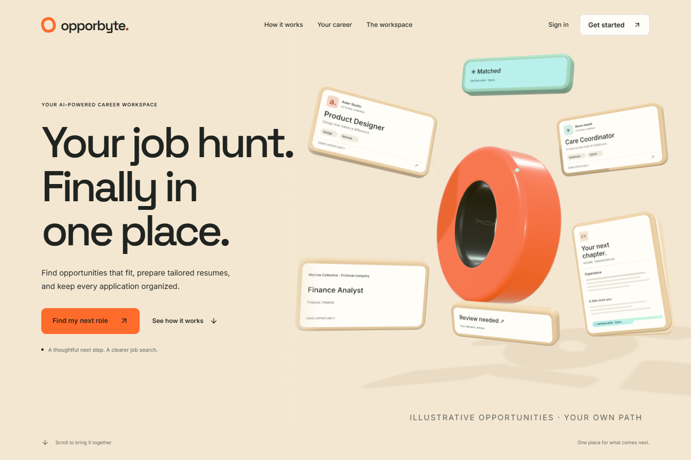
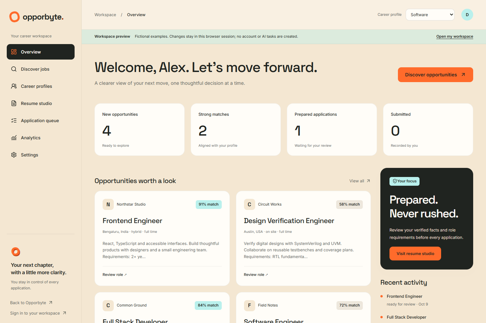

# Opporbyte frontend review gallery

The local production preview is running at <http://127.0.0.1:3001/>.
Use <http://127.0.0.1:3001/preview> to inspect the workspace with clearly labeled
fictional examples. The authenticated workspace uses the existing backend and
owner account. No GitHub changes have been published.

The production screenshots below show the actual browser render. Interactive
motion is best reviewed in the running preview. Mobile images use Chromium
viewport emulation rather than a physical phone.

## Hero, mobile and accessibility

| Capture | What to review |
| --- | --- |
| [Desktop hero](redesign-hero-desktop.png) | Original extruded orange O, dark inner wall, paper thickness, lighting, shadows, readable text and CTAs |
| [Organized hero](redesign-hero-organized.png) | Scroll convergence into a miniature workspace |
| [390px mobile](redesign-mobile-hero.png) | Separate simplified composition and visible primary CTA |
| [320px mobile](redesign-hero-320.png) | Narrow layout without horizontal overflow |
| [Reduced motion](redesign-reduced-motion.png) | Frozen three-quarter arrangement without sticky choreography |
| [WebGL fallback](redesign-webgl-fallback.png) | Lightweight visual with usable text and controls |

## Public sections

| Section | Capture |
| --- | --- |
| Goodbye, Endless Tabs | [Scattered tasks become organized](redesign-section-endless-tabs.png) |
| Made for Every Career | [Interactive career preferences](redesign-section-careers.png) |
| How Opporbyte Works | [Four-stage timeline](redesign-section-how-it-works.png) |
| One Beautiful Workspace | [Interactive product demonstration](redesign-section-workspace.png) |
| Resumes That Fit the Role | [Verified-fact comparison](redesign-section-resumes.png) |
| You're in Control | [Human review and approval](redesign-section-control.png) |
| Cinematic Finale | [Cream-to-ink closing composition](redesign-section-finale-title.png) |
| FAQ and Footer | [Accessible disclosures and navigation](redesign-section-faq.png) |

## Onboarding and sign-in

- [Career interest step](redesign-get-started.png)
- [Final review step](redesign-onboarding-review.png)
- [Existing owner login](redesign-login.png)

## Workspace

These captures show the explicitly labeled, in-memory demo. Separate browser
checks exercised the real APIs against an isolated QA database, including
cookie authentication, profile editing, verified facts, resume tailoring,
exports, application staging and approval, analytics and logout.

| Page | Capture |
| --- | --- |
| Dashboard | [Overview](redesign-preview.png) |
| Discover Jobs | [Search and filters](redesign-preview-discover.png) |
| Job Details | [Role evidence and preparation](redesign-preview-jobs-job-1.png) |
| Career Profiles | [Profile configuration](redesign-preview-profiles.png) |
| Resume Studio | [Facts and versions](redesign-preview-resumes.png) |
| Application Queue | [Review and statuses](redesign-preview-applications.png) |
| Analytics | [Pipeline and activity](redesign-preview-analytics.png) |
| Settings | [Account and preferences](redesign-preview-settings.png) |

See [the full handoff](../FRONTEND_REDESIGN_HANDOFF.md) for completed routes,
specialist contributions, test evidence, current product limits and run
instructions.
