# Stabilization review gallery — 11 October 2026

Tested frontend: `fdd713ba59276521e88a43396833498e52c35f64`, local branch
`design/full-frontend-redesign`. Screenshots are actual Chromium captures.
Workspace records are fictional isolated-backend fixtures. Desktop/mobile here
means viewport emulation, not physical-device testing.

## Production hero

The desktop capture is paused for a still frame; Resume motion is a working control.

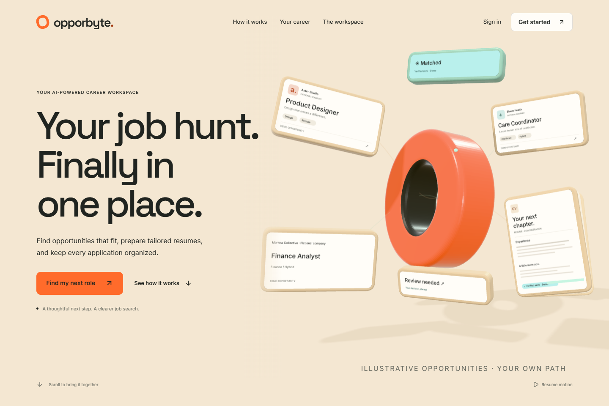
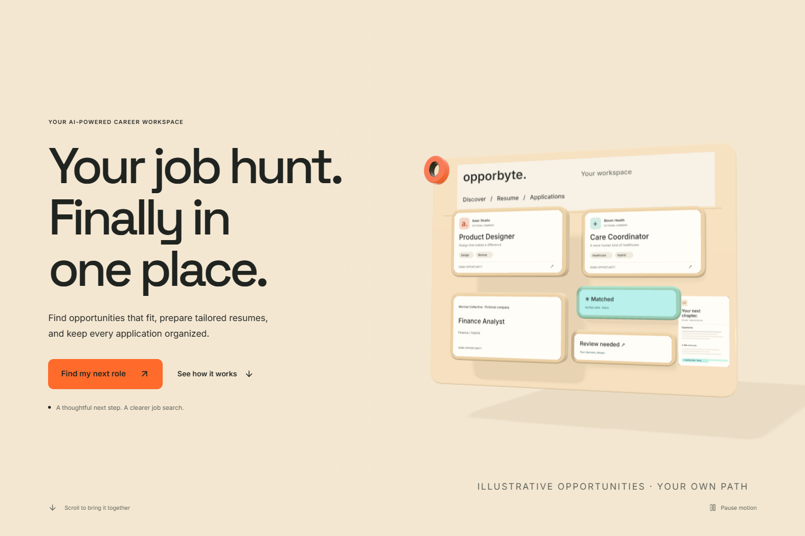
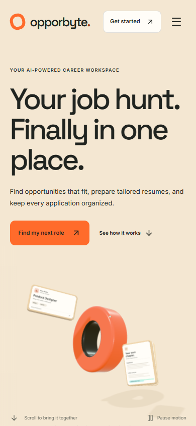
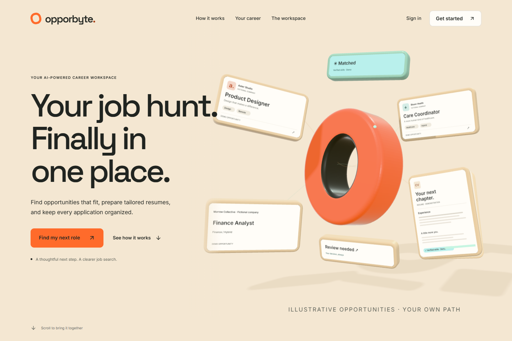
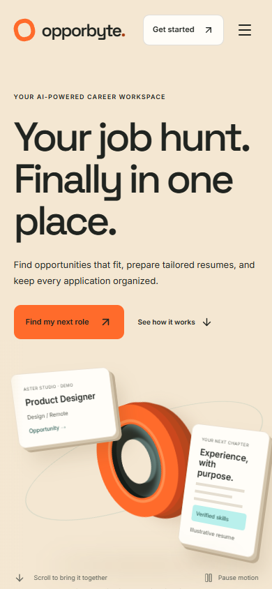

## Closing scene

The profile, opportunity and review card share an aligned grid and keep the
workspace heading clear throughout the assembly.

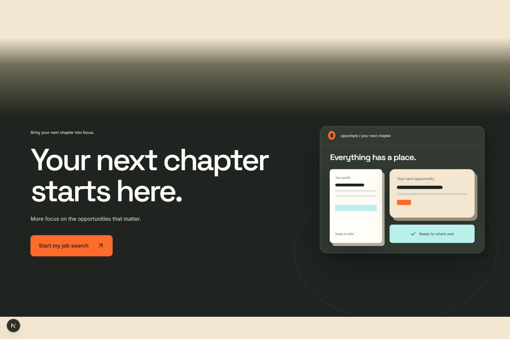
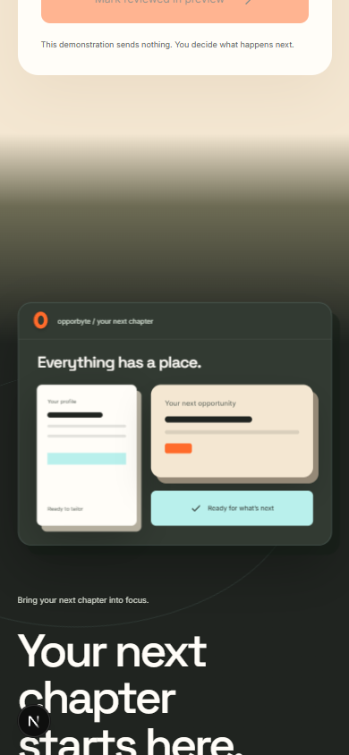

## Onboarding preview

This is a public preference demonstration, with no resume upload or registration.

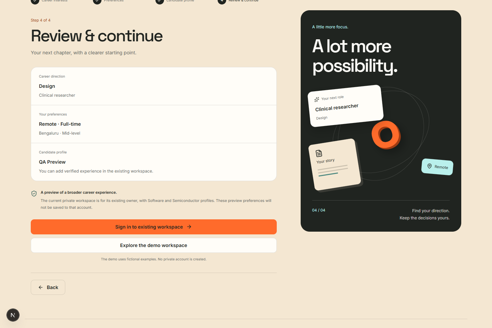
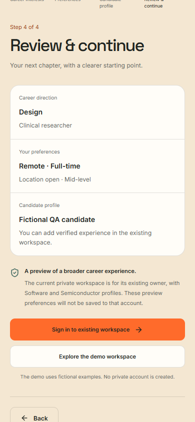

## API-connected fixture workspace

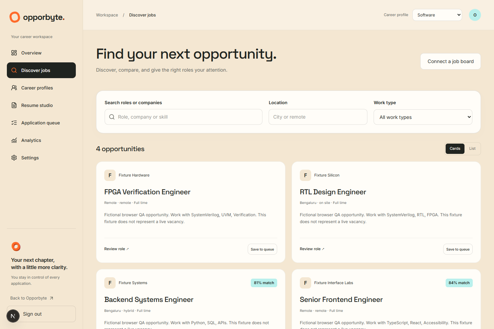
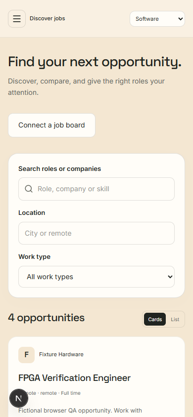
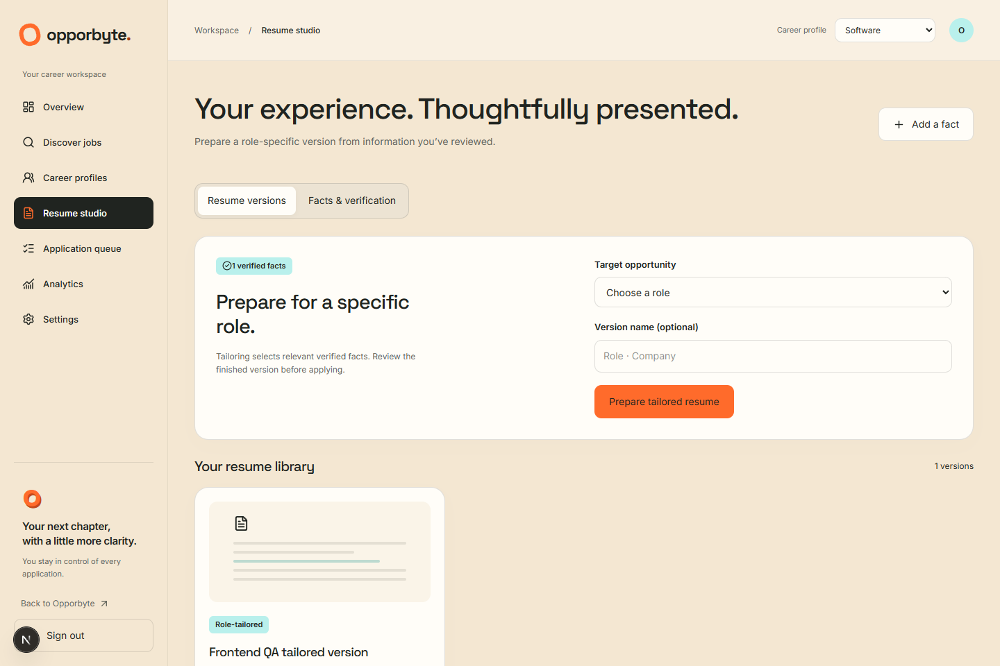
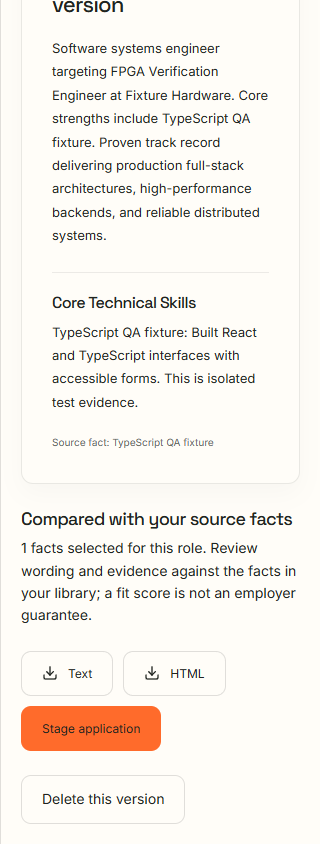

See [the full QA report](../../FRONTEND_QA_REPORT.md) for statuses, test counts,
limitations and local instructions, and [raw browser results](QA_RESULTS.json)
for case-level evidence.
